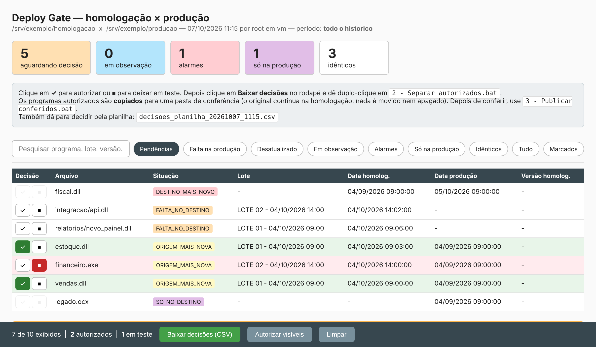

# Deploy Gate

[](https://github.com/Guara10/deploy-gate/actions/workflows/testes.yml)

Controle de publicação de binários da **homologação** para a **produção**, em PowerShell, com conferência humana, verificação por hash e trilha de auditoria.



## O problema

Em muitas empresas de software o deploy ainda é assim: o desenvolvedor compila, o arquivo vai para uma pasta de homologação, alguém testa e depois **alguém copia à mão** para a pasta de produção, de onde os clientes recebem a atualização.

Na prática, a cópia manual falha:

- programas testados ficam semanas sem ir para produção porque ninguém lembrou de copiar;
- ninguém sabe dizer **o que está diferente** entre homologação e produção;
- às vezes alguém corrige direto na produção, e a próxima cópia da homologação **apaga essa correção** sem ninguém perceber;
- não existe registro de quem liberou o quê, nem quando.

Comparar por data de modificação não resolve, porque copiar, restaurar backup ou sincronizar pastas muda a data sem mudar o conteúdo.

## A solução

Um script que transforma a cópia manual num fluxo de 3 etapas, sempre com uma pessoa decidindo:

```
 homologação ──► 1. comparar ──► relatório HTML ──► decisão (autorizar / em teste)
                                                          │
 produção ◄── 3. publicar ◄── pasta de conferência ◄── 2. separar
              (revalida hash)   + _manifesto.csv
```

1. **Comparar.** Lê as duas pastas, calcula o SHA1 de cada arquivo e classifica cada um:

   | Situação | Significado | Pode autorizar? |
   |---|---|---|
   | `FALTA_NO_DESTINO` | arquivo novo, ainda não foi para produção | sim |
   | `ORIGEM_MAIS_NOVA` | recompilado na homologação | sim |
   | `DESTINO_MAIS_NOVO` / `DIVERGENTE_MESMA_DATA` | **alarme**: produção foi alterada por fora | não, exige análise manual |
   | `SO_NO_DESTINO` | só existe em produção | não |
   | `EM_OBSERVACAO` | marcado "em teste" anteriormente | sim |
   | `IGUAL` | mesmo conteúdo | — |

   As pendências são agrupadas em **lotes de compilação** (arquivos gerados com poucos minutos de diferença), porque normalmente são liberados juntos.

2. **Separar.** Os arquivos autorizados são **copiados** para uma pasta de conferência junto com um `_manifesto.csv` que guarda o hash autorizado. A homologação e a produção não são tocadas nesta etapa.

3. **Publicar.** Depois de alguém conferir a pasta, o script publica na produção. O hash de cada arquivo é revalidado contra o manifesto e tudo vai para `publicacoes.csv`, com quem autorizou e quem conferiu.

## Proteções

Cada uma delas tem um teste automatizado em [`tests/Run-Tests.ps1`](tests/Run-Tests.ps1):

- **Hash, não data.** A data só serve para agrupar lotes. O que decide se dois arquivos são iguais é o SHA1.
- **Recompilou depois da decisão → recusado.** Se o arquivo mudou entre a autorização e a separação, ele não é separado, porque a pessoa autorizou outra versão.
- **Adulterado na pasta de conferência → recusado.** O hash é conferido de novo na publicação.
- **Arquivo largado na pasta de conferência fora do manifesto → ignorado e avisado.**
- **Produção mais nova → nunca é sobrescrita.** Essa trava existe no relatório *e* no script. O CSV de decisões pode ser editado à mão, então a interface sozinha não é uma barreira. A checagem é refeita na separação e na publicação.
- **"Em teste" com memória.** Um arquivo marcado como em teste sai da fila enquanto o binário não mudar. Se for recompilado, volta sozinho. O relatório mostra há quantos dias cada um está parado.
- **Modo simulação** (`-Simular`) para ver o que aconteceria sem alterar nada.

## Como usar

Requisitos: Windows PowerShell 5.1 ou PowerShell 7 (Windows, Linux ou macOS). O Excel é opcional: sem ele, a planilha de decisões sai em CSV.

### Testar com dados fictícios

```powershell
.\demo\New-DemoEnvironment.ps1
.\src\DeployGate.ps1 -Config .\demo\ambiente\config.psd1
```

O relatório abre no navegador com um exemplo de cada situação.

### Usar de verdade

```powershell
Copy-Item .\src\config.example.psd1 .\src\config.psd1
# edite os caminhos de Origem, Destino e PastaSaida
```

Depois, no Windows, dê dois cliques nos `.bat` da pasta `src`, na ordem:

| Arquivo | O que faz |
|---|---|
| `0 - Diagnostico.bat` | conta os arquivos por situação e exporta tudo em CSV (útil na primeira vez) |
| `1 - Gerar comparativo.bat` | gera o relatório HTML |
| `2 - Separar autorizados.bat` | acha o `decisoes.csv` baixado e monta a pasta de conferência |
| `3 - Publicar conferidos.bat` | publica a última pasta conferida |

Ou pela linha de comando:

```powershell
.\src\DeployGate.ps1                                   # comparar
.\src\DeployGate.ps1 -DataInicio 01/07/2026 -DataFim 31/07/2026
.\src\DeployGate.ps1 -AplicarUltima                    # separar
.\src\DeployGate.ps1 -PublicarUltima                   # publicar
.\src\DeployGate.ps1 -Aplicar .\decisoes.csv -ParaStaging -Simular
```

Para rodar sem perguntas (Agendador de Tarefas, CI), use `-Silencioso`, `-Responsavel "Nome"` e `-Confirmar`.

## Testes

```powershell
.\tests\Run-Tests.ps1
```

São 11 testes de ponta a ponta. Cada um cria um ambiente fictício novo e roda o script como processo separado, do mesmo jeito que os `.bat` fazem. O GitHub Actions roda a suíte em Windows PowerShell 5.1, PowerShell 7 no Windows e PowerShell 7 no Linux.

## Estrutura

```
src/
  DeployGate.ps1          script principal
  config.example.psd1     modelo de configuração (config.psd1 fica fora do Git)
  0..3 - *.bat            atalhos para quem não usa terminal
demo/
  New-DemoEnvironment.ps1 gera homologação/produção fictícias
tests/
  Run-Tests.ps1           testes sem dependências externas
```

## Licença

MIT
